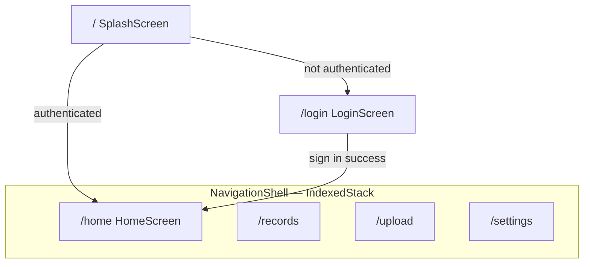

# Aarogya Vault — Navigation Architecture

Navigation shell for the Flutter MVP using **GoRouter**, **Riverpod**, and **Material 3** with the Stitch design system.

## Route tree

```
/                          → SplashScreen
/login                     → LoginScreen

StatefulShellRoute (IndexedStack)
├── /home                  → HomeScreen        (branch 0)
├── /records               → RecordsScreen     (branch 1)
├── /upload                → UploadScreen      (branch 2)
└── /settings              → SettingsScreen    (branch 3)
```

### Path constants

Defined in `lib/app/router/app_routes.dart`:

| Constant | Path |
|----------|------|
| `AppRoutes.splash` | `/` |
| `AppRoutes.login` | `/login` |
| `AppRoutes.home` | `/home` |
| `AppRoutes.records` | `/records` |
| `AppRoutes.upload` | `/upload` |
| `AppRoutes.settings` | `/settings` |

## Navigation flow



1. **Cold start** — `initialLocation: /` loads `SplashScreen`.
2. **Auth bootstrap** — splash listens to `authBootstrapProvider`:
   - Authenticated → `context.go('/home')`
   - Unauthenticated → `context.go('/login')`
3. **Login** — on auth success → `context.go('/home')`
4. **Authenticated app** — user navigates within `NavigationShell` via bottom tabs or deep links.

## Shell implementation

| File | Role |
|------|------|
| `lib/app/router/app_router.dart` | `GoRouter` + `StatefulShellRoute.indexedStack` |
| `lib/app/router/navigation_shell.dart` | Bottom nav + `StatefulNavigationShell` body |
| `lib/app/router/app_routes.dart` | Path and branch index constants |
| `lib/app/router/router_providers.dart` | `goRouterProvider` (Riverpod) |

### Tab state preservation

`StatefulShellRoute.indexedStack` keeps all four branch navigators alive in an **IndexedStack**:

- Widget state is preserved when switching tabs.
- Each tab screen uses a `PageStorageKey` on its scroll view so scroll offset is restored.
- Tab switches use `navigationShell.goBranch(index)` — no full route rebuild.

### Bottom navigation (Stitch layout)

`NavigationShell` renders a custom bottom bar (not default `NavigationBar`):

- **Light:** active tab = primary teal icon + label; inactive = muted gray.
- **Dark:** active tab = teal icon inside pill (`darkNavActivePill`); inactive = muted gray.
- Height: `AppSpacing.bottomNavHeight` (64px).
- Icons: Home, Records, Upload (+ circle), Settings.

## Deep-link strategy

### Supported URIs

| URI | Result |
|-----|--------|
| `aarogyavault://home` / `/home` | Opens Home tab (branch 0) |
| `/records` | Opens Records tab (branch 1) |
| `/upload` | Opens Upload tab (branch 2) |
| `/settings` | Opens Settings tab (branch 3) |
| `/login` | Login screen (outside shell) |
| `/` | Splash (auth redirect) |

### How it works

1. GoRouter matches the path to the correct `StatefulShellBranch`.
2. `IndexedStack` displays the matching branch without destroying others.
3. `NoTransitionPage` avoids slide animations on tab switches (Stitch tab behaviour).

### Future: auth guards

Add a `redirect` on the shell route:

```dart
redirect: (context, state) {
  final isLoggedIn = /* auth check */;
  if (!isLoggedIn) return AppRoutes.login;
  return null;
},
```

Deep links to `/records` while logged out would redirect to `/login`, then return to `/records` after sign-in (store `state.uri` as `redirect` target).

### Future: nested routes

Each `StatefulShellBranch` can gain child routes, e.g.:

```
/records           → RecordsScreen
/records/:id       → RecordDetailScreen (same branch stack)
```

Detail screens would hide the bottom nav or use a root navigator overlay — implement when Stitch detail screens are wired.

## Riverpod integration

```dart
// main.dart
class AarogyaVaultApp extends ConsumerWidget {
  Widget build(context, ref) {
    final router = ref.watch(goRouterProvider);
    return MaterialApp.router(routerConfig: router, ...);
  }
}
```

`goRouterProvider` returns a fresh `GoRouter` from `createAppRouter()`. Override in tests to inject a custom router if needed.

## Placeholder screens

Current tab screens are lightweight placeholders with scrollable content only:

| Screen | Path | Future Stitch screen |
|--------|------|----------------------|
| `HomeScreen` | `/home` | Dashboard |
| `RecordsScreen` | `/records` | Record Library |
| `UploadScreen` | `/upload` | Upload Record |
| `SettingsScreen` | `/settings` | Settings |

`DashboardScreen` (`/dashboard`) is **deprecated** — replaced by `HomeScreen` at `/home`. Legacy `/dashboard` references were updated to `/home`.

## Tests

```bash
cd apps/mobile_app
flutter analyze
flutter test test/app/router/
```

`test/app/router/navigation_shell_test.dart` covers:

- Bottom nav labels render
- Tab switching
- Scroll position preservation (IndexedStack)
- Deep link to `/records`
