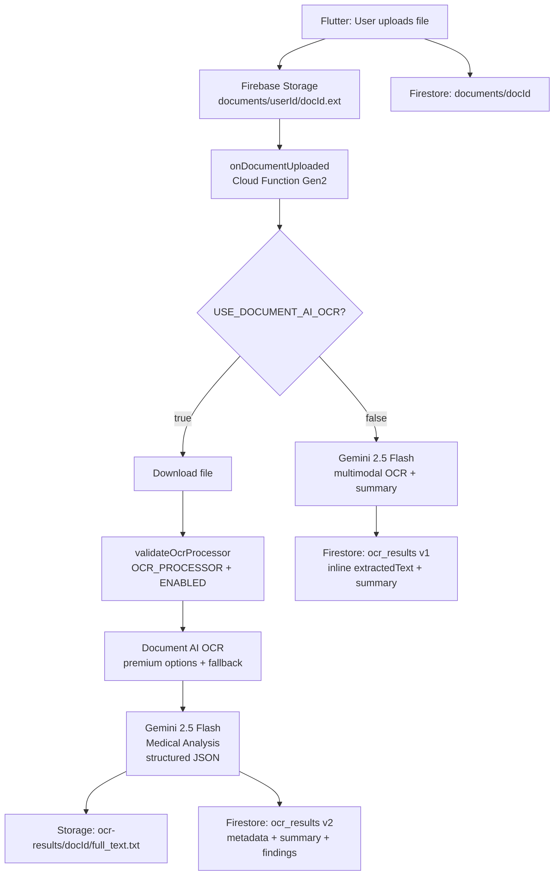

# Aarogya Vault — MVP Architecture & Implementation Audit

**Audit date:** June 2026  
**Auditor role:** Senior Staff Engineer (read-only inspection)  
**Repository:** `aarogya-vault` monorepo  
**Firebase project (observed in code):** `aarogya-vault-dev`

This report is based solely on files present in the repository at audit time. Where something could not be verified from code, it is marked **"Not found in repository."**

---

## Executive Summary

Aarogya Vault has a **working backend OCR pipeline** (Document AI → Gemini medical analysis → Storage + Firestore) and a **functional but minimal Flutter client** (Google Sign-In, upload, list, delete). The largest gap between backend capability and user value is the **missing mobile UI for OCR/medical insights** — the OCR feature module is fully wired at the data layer but has **zero presentation screens**.

| Area | Status | Completion (approx.) |
|------|--------|----------------------|
| Backend OCR pipeline | Production-ready with rollback | **90%** |
| Flutter auth + upload | Working, minimal UI | **70%** |
| Flutter OCR / insights UI | Data layer only | **15%** |
| Search / Settings / Notifications | Not found in repository | **0%** |
| Shared packages / monorepo packages | Empty `packages/` directory | **0%** |
| Website (marketing + waitlist) | Implemented | **85%** |

---

## 1. Repository Structure Audit

### 1.1 Folder Tree (top-level)

```
aarogya-vault/
├── apps/
│   └── mobile_app/          # Flutter app (only app in monorepo)
├── backend/
│   └── functions/           # Firebase Cloud Functions (TypeScript)
├── website/
│   └── public/              # Firebase Hosting static site
├── docs/
│   ├── document-ai-setup.md
│   ├── startup/             # Google for Startups application docs
│   └── MVP_AUDIT_JUNE_2026.md  (this file)
├── packages/                # EMPTY — no shared packages
├── firebase.json            # Hosting, Functions, Firestore, Storage config
├── melos.yaml               # Monorepo tooling (references packages/**)
└── README.md
```

### 1.2 `apps/mobile_app` — Architecture Observations

- **Pattern:** Feature-first clean architecture (`application` / `data` / `domain` / `presentation`).
- **Routing:** GoRouter with 3 routes (`/`, `/login`, `/dashboard`).
- **State:** Riverpod (`Provider`, `StreamProvider`, `FutureProvider`) — manual providers only; **no** `@riverpod` code generation despite `riverpod_generator` in `pubspec.yaml`.
- **Models:** Plain Dart classes — **Freezed is declared in `pubspec.yaml` but no `.freezed.dart` files exist** (not used).
- **Features present:** `auth`, `user`, `document`, `ocr`, `splash`, `dashboard`.
- **Features absent:** `search`, `settings`, `notifications`, `vault` (as a dedicated module — dashboard acts as vault).

### 1.3 `backend/functions` — Architecture Observations

- **Single exported trigger:** `onDocumentUploaded` (`src/index.ts`).
- **OCR abstraction:** `src/services/ocr/` (Document AI) + legacy `src/services/gemini_ocr_provider.ts`.
- **Medical analysis:** `src/services/medical/medical_analysis_provider.ts`.
- **Storage offload:** `src/services/storage/ocr_text_store.ts`.
- **GenAI migration prep:** `src/services/genai/` (interface + Vertex impl + placeholder — **not wired into providers**).
- **Tests:** 7 Jest suites, 59 tests (`npm test` passes per `package.json` scripts).

### 1.4 `packages/`

**Not found in repository** — directory exists but is **empty**. `melos.yaml` references `packages/**` but no shared libraries are implemented.

### 1.5 `docs/`

| Path | Purpose |
|------|---------|
| `docs/document-ai-setup.md` | Document AI processor setup guide |
| `docs/startup/*.md` | Startup application materials (5 files) |

### 1.6 Missing Modules / Orphaned Code

| Item | Location | Observation |
|------|----------|-------------|
| Empty `packages/` | `/packages` | Melos bootstrap target with no packages |
| Empty core dirs | `lib/core/network`, `lib/core/utils`, `lib/core/extensions` | Directories exist, **no files** |
| `LoggerService` | `lib/core/services/logger_service.dart` | Defined, **never imported** elsewhere |
| `dioProvider` | `lib/app/providers/network_providers.dart` | Defined, **never consumed** by features |
| Duplicate `OcrProvider` | `services/ocr_provider.ts` vs `services/ocr/ocr_provider.ts` | Two interfaces: file-path (Gemini legacy) vs buffer (Document AI) |
| `GenAiGeminiClient` | `services/genai/genai_gemini_client.ts` | Placeholder throwing "not implemented" |
| `VertexGeminiClient` | `services/genai/vertex_gemini_client.ts` | Implemented but **not used** by OCR/analysis providers |
| OCR presentation layer | `features/ocr/` | Full data/domain/application layer; **no `presentation/` screens** |
| `OcrState` classes | `ocr_state.dart` | Defined; **not referenced** by any screen |
| Unused pubspec deps | `pubspec.yaml` | `firebase_messaging`, `firebase_crashlytics`, `firebase_app_check`, `image_picker`, `cached_network_image`, `lottie`, `connectivity_plus` — **not imported in `lib/`** |
| Widget test | `test/widget_test.dart` | Placeholder `expect(true, true)` only |

---

## 2. Flutter Audit

### 2.1 Implemented

#### Screens (3 total)

| Screen | Route | File |
|--------|-------|------|
| Splash | `/` | `features/splash/presentation/screens/splash_screen.dart` |
| Login | `/login` | `features/auth/presentation/screens/login_screen.dart` |
| Dashboard | `/dashboard` | `features/dashboard/presentation/screens/dashboard_screen.dart` |

#### Routes

```dart
/ → SplashScreen
/login → LoginScreen
/dashboard → DashboardScreen
```

(`lib/app/router/app_router.dart`)

#### Providers (observed)

| Provider | Feature | Purpose |
|----------|---------|---------|
| `firebaseAuthProvider`, `firestoreProvider`, `firebaseStorageProvider` | app | Firebase singletons |
| `authRepositoryProvider`, `authControllerProvider`, `authStateChangesProvider`, `authBootstrapProvider` | auth | Auth state + bootstrap |
| `userRepositoryProvider`, `userServiceProvider` | user | User CRUD |
| `documentRepositoryProvider`, `documentServiceProvider`, `documentControllerProvider`, `userDocumentsProvider` | document | Upload, list, delete |
| `ocrRepositoryProvider`, `ocrControllerProvider`, `ocrResultProvider` | ocr | Read OCR results (unused in UI) |
| `dioProvider` | app | HTTP client (unused) |

#### Repositories

| Repository | Collection | File |
|------------|------------|------|
| `FirebaseAuthRepository` | Firebase Auth | `auth/data/repositories/` |
| `FirestoreUserRepository` | `users` | `user/data/repositories/` |
| `FirestoreDocumentRepository` | `documents` | `document/data/repositories/` |
| `FirestoreOcrRepository` | `ocr_results` + Storage | `ocr/data/repositories/` |

#### Models / Entities

| Entity | File | Notes |
|--------|------|-------|
| `AuthUser` | `auth/domain/entities/auth_user.dart` | id, email, displayName, photoUrl |
| `AppUser` | `user/domain/entities/app_user.dart` | Firestore user profile |
| `AppDocument` | `document/domain/entities/app_document.dart` | Document metadata |
| `OcrResult` | `ocr/domain/entities/ocr_result.dart` | v1 + v2 fields, Storage-backed text support |
| `DocumentType` enum | `document/domain/enums/document_type.dart` | 7 types |

#### Services

| Service | Implementation |
|---------|----------------|
| `GoogleAuthService` | Google Sign-In → Firebase Auth |
| `FirestoreUserService` | Create user on first login, update last login |
| `FirestoreDocumentService` | Upload to Storage + create Firestore doc |
| `FirebaseStorageService` | Storage upload/delete |

### 2.2 Partially Implemented

| Feature | What exists | What's missing |
|---------|-------------|----------------|
| **Authentication** | Google Sign-In, user bootstrap, `signOut()` in controller | No sign-out UI; no profile screen |
| **Dashboard / Vault** | List documents, upload (PDF/JPG/PNG), soft-delete | No document detail, no viewer, no OCR status |
| **OCR / Medical Insights** | Repository, mapper, providers, v2 Storage text loading | **No UI** consuming `ocrResultProvider` |
| **Document delete** | Deletes Storage file + sets `isDeleted: true` | No UI confirmation; orphaned Firestore metadata remains |
| **Theming** | `AppTheme` light/dark | Minimal styling on functional screens |

### 2.3 Missing (Not Found in Repository)

| Feature | Status |
|---------|--------|
| Dedicated **Vault** module/screen (beyond basic dashboard list) | Not found — dashboard serves as vault |
| **Search** (documents, OCR text, findings) | Not found in repository |
| **Settings** screen | Not found in repository |
| **Notifications** (FCM integration) | `firebase_messaging` in pubspec; **no `lib/` usage** |
| **Document detail** screen | Not found in repository |
| **Medical summary viewer** | Not found in repository |
| **Critical findings UI** | Not found in repository |
| **Sign-out button** | Controller method exists; **no UI** |
| **Freezed / json_serializable models** | Dependencies declared; **no generated files** |
| **Flutter widget/integration tests** | Only placeholder test |

### 2.4 Feature Completion Percentages

| Feature | Status | % | Evidence |
|---------|--------|---|----------|
| Authentication | In Progress | **75%** | Full Google flow; missing sign-out UI, profile |
| Document Upload | Completed (basic) | **80%** | Upload + type picker + Storage + Firestore |
| Vault (list/manage) | In Progress | **45%** | List + delete only; no detail, filter, categories UI |
| OCR (client) | In Progress | **20%** | Data layer complete; zero presentation |
| Medical Insights (client) | Not Started (UI) | **10%** | Backend produces data; app does not display it |
| Search | Not Started | **0%** | Not found in repository |
| Settings | Not Started | **0%** | Not found in repository |
| Notifications | Not Started | **0%** | Dependency only; not wired |

**Overall Flutter MVP completion (weighted toward user-visible value): ~40%**

---

## 3. Backend Audit

### 3.1 Implemented

#### Upload Pipeline

1. Mobile uploads file → Firebase Storage `documents/{userId}/{documentId}.{ext}`
2. Mobile creates Firestore `documents/{documentId}` record
3. Storage `onObjectFinalized` trigger fires (`onDocumentUploaded`)

#### OCR Pipeline (production path when `USE_DOCUMENT_AI_OCR=true`)

```
onDocumentUploaded
  → validate storage path (regex: documents/{userId}/{documentId}.{ext})
  → validate content-type (pdf, jpeg, png) + size (≤10 MB)
  → skip if ocr_results/{documentId} already exists
  → download file from Storage
  → validateOcrProcessor (type OCR_PROCESSOR, state ENABLED)
  → DocumentAiOcrProvider.extractText (premium OCR options + fallback)
  → MedicalAnalysisProvider.analyze (Gemini 2.5 Flash, structured JSON)
  → OcrTextStore.saveText → ocr-results/{documentId}/full_text.txt
  → OcrResultStore.saveAnalyzedResult → Firestore ocr_results (v2)
```

#### Legacy Rollback Path (`USE_DOCUMENT_AI_OCR=false`)

```
onDocumentUploaded
  → (same validation)
  → GeminiOcrProvider.extractText (Vertex AI, multimodal OCR + summary)
  → OcrResultStore.saveResult → Firestore ocr_results (v1, inline extractedText)
```

#### Storage Services

| Service | File | Role |
|---------|------|------|
| `DocumentDownloadService` | `services/document_download_service.ts` | Download uploaded file for processing |
| `OcrTextStore` | `services/storage/ocr_text_store.ts` | Persist full OCR text to Storage |

#### Security (backend)

- Cloud Functions use Firebase Admin SDK (bypasses client rules for writes).
- Structured logging policy: no OCR text, summaries, or PHI in logs (verified: no `RAW GEMINI RESPONSE` patterns in `src/`).
- PHI debug logs removed from `gemini_ocr_provider.ts`.

### 3.2 Document AI Integration — Verified

| Component | File | Status |
|-----------|------|--------|
| SDK | `@google-cloud/documentai@^9.6.2` | Installed |
| Config | `config/document_ai_config.ts` | `getDocumentAiConfig()`, `isDocumentAiOcrEnabled()` |
| Provider | `services/ocr/document_ai_ocr_provider.ts` | Weighted token confidence, handwriting detection |
| Validator | `services/ocr/document_ai_processor_validator.ts` | Accepts `OCR_PROCESSOR`, checks `ENABLED` |
| Premium options | `processOptions.ocrConfig` | `enableNativePdfParsing`, `enableImageQualityScores`, `computeStyleInfo` with fallback |

### 3.3 Gemini Integration — Verified

| Use | File | Model | Auth |
|-----|------|-------|------|
| Medical analysis (v2) | `medical_analysis_provider.ts` | `gemini-2.5-flash` | Vertex AI (`asia-south1`) |
| Legacy OCR (v1 rollback) | `gemini_ocr_provider.ts` | `gemini-2.5-flash` | Vertex AI (`asia-south1`) |

Both use `responseMimeType: "application/json"` + `responseSchema` (structured output).

### 3.4 Firestore Writes — Verified

| Writer | Collection | Schema version |
|--------|------------|----------------|
| Mobile app | `documents` | User-uploaded metadata |
| Mobile app | `users` | User profile |
| Cloud Function | `ocr_results` | v1 (legacy) or v2 (analyzed) |
| Website JS | `waitlist` | Public form submissions |

### 3.5 Storage Writes — Verified

| Writer | Path | Content |
|--------|------|---------|
| Mobile app | `documents/{userId}/{documentId}.{ext}` | Original uploaded file |
| Cloud Function | `ocr-results/{documentId}/full_text.txt` | Full OCR extracted text (v2) |

### 3.6 Technical Debt (Backend)

| Issue | Severity | Location |
|-------|----------|----------|
| Duplicate `OcrProvider` interfaces | LOW | `services/ocr_provider.ts` vs `services/ocr/ocr_provider.ts` |
| Hardcoded GCP project/location | MEDIUM | `gemini_ocr_provider.ts`, `medical_analysis_provider.ts` (`aarogya-vault-dev`, `asia-south1`) |
| GenAI adapter not wired | LOW | `services/genai/` exists but providers call Vertex SDK directly |
| Document AI location (`us`) vs Vertex location (`asia-south1`) split | MEDIUM | Cross-region latency/cost |
| `.env.example` still says "NOT basic OCR_PROCESSOR" | LOW | Contradicts fixed validator (API type is `OCR_PROCESSOR`) |
| Single Cloud Function — no HTTP endpoints | LOW | All processing is async via Storage trigger |
| No re-processing / admin API | MEDIUM | Cannot re-OCR without deleting `ocr_results` doc + re-uploading |

### 3.7 Legacy / Unused Backend Files

| File | Status |
|------|--------|
| `services/gemini_ocr_provider.ts` | **Active** — legacy rollback path (intentional) |
| `services/ocr_provider.ts` | **Active** — Gemini legacy interface |
| `services/genai/genai_gemini_client.ts` | Placeholder only |
| `services/genai/vertex_gemini_client.ts` | Implemented, unused |
| `services/ocr/ocr_record_compat.ts` | Utility for v1/v2 text resolution (no production caller in trigger; used in tests) |

---

## 4. Firestore Audit

### 4.1 Collections (all observed)

```
Firestore
├── users/{userId}
├── documents/{documentId}
├── ocr_results/{documentId}
└── waitlist/{entryId}
```

**Subcollections:** Not found in repository.

### 4.2 Document Schemas

#### `users/{userId}`

| Field | Type | Written by | Read by |
|-------|------|------------|---------|
| `uid` | string | Mobile | Mobile |
| `email` | string? | Mobile | Mobile |
| `displayName` | string? | Mobile | Mobile |
| `photoUrl` | string? | Mobile | Mobile |
| `createdAt` | Timestamp | Mobile | Mobile |
| `lastLoginAt` | Timestamp | Mobile | Mobile |
| `isActive` | bool | Mobile | Mobile |

**Status:** Used

#### `documents/{documentId}`

| Field | Type | Written by | Read by |
|-------|------|------------|---------|
| `id` | string | Mobile | Mobile |
| `ownerId` | string | Mobile | Mobile, Rules, Storage Rules |
| `fileName` | string | Mobile | Mobile |
| `documentType` | string (enum name) | Mobile | Mobile |
| `storagePath` | string | Mobile | Mobile, Function (via event) |
| `downloadUrl` | string | Mobile | Mobile |
| `createdAt` | Timestamp | Mobile | Mobile |
| `updatedAt` | Timestamp | Mobile | Mobile |
| `isDeleted` | bool | Mobile | Mobile |

**Status:** Used  
**Index:** Composite on `ownerId + isDeleted + createdAt` (`firestore.indexes.json`)

#### `ocr_results/{documentId}` — v1 (legacy)

| Field | Type | Written by |
|-------|------|------------|
| `documentId` | string | Function |
| `extractedText` | string (inline, can be large) | Function |
| `summary` | string | Function |
| `createdAt` | Timestamp | Function |

**Status:** Used (rollback path only when `USE_DOCUMENT_AI_OCR=false`)

#### `ocr_results/{documentId}` — v2 (production)

| Field | Type | Written by | Read by |
|-------|------|------------|---------|
| `documentId` | string | Function | Mobile |
| `ocrProvider` | string (`document_ai`) | Function | Not read by mobile UI |
| `ocrConfidence` | number? | Function | Not read by mobile UI |
| `pageCount` | number? | Function | Not read by mobile UI |
| `documentType` | string | Function | Mapper (optional field) |
| `ocrTextPath` | string | Function | Mobile (loads text from Storage) |
| `ocrCharacterCount` | number | Function | Mapper (optional field) |
| `summary` | string | Function | Mobile |
| `criticalFindings` | array | Function | **Not read by mobile** |
| `normalFindings` | string[] | Function | **Not read by mobile** |
| `recommendedFollowUp` | string[] | Function | **Not read by mobile** |
| `processingVersion` | number (2) | Function | Mapper (optional field) |
| `handwritingDetected` | bool? | Function | Not read by mobile UI |
| `extractionWarning` | string? | Function | Not read by mobile UI |
| `createdAt` | Timestamp | Function | Mobile |

**Status:** Used (production path)  
**Note:** `riskLevel` is mapped in Flutter `OcrResult` entity but **not written by current backend** `saveAnalyzedResult()`.

#### `waitlist/{entryId}`

| Field | Type | Written by | Read by |
|-------|------|------------|---------|
| `name` | string | Website | Denied (rules) |
| `email` | string | Website | Denied (rules) |
| `createdAt` | server timestamp | Website | Denied (rules) |
| `source` | string (`website`) | Website | Denied (rules) |

**Status:** Used (website only)

### 4.3 ER-Style Relationship Diagram

```
┌─────────────┐         ┌──────────────────┐         ┌─────────────────┐
│   users     │         │    documents     │         │   ocr_results   │
│  {userId}   │◄────────│  {documentId}    │────────►│  {documentId}   │
│             │ ownerId │                  │  same ID│                 │
│ uid         │         │ ownerId          │         │ summary         │
│ email       │         │ fileName         │         │ ocrTextPath ────┼──► Storage
│ displayName │         │ documentType     │         │ criticalFindings│
│ createdAt   │         │ storagePath ─────┼──► Storage│ processingVersion│
│ lastLoginAt │         │ downloadUrl      │         │ ocrConfidence   │
│ isActive    │         │ isDeleted        │         │ ...             │
└─────────────┘         └──────────────────┘         └─────────────────┘

┌─────────────┐
│  waitlist   │  (standalone — website signups, no FK)
│  {entryId}  │
│ name, email │
└─────────────┘
```

### 4.4 Planned but Missing Collections

| Collection | Evidence |
|------------|----------|
| `notifications` | Not found in repository |
| `search_index` / `embeddings` | Not found in repository |
| `user_preferences` / `settings` | Not found in repository |
| `audit_logs` | Not found in repository |

---

## 5. Storage Audit

### 5.1 Current Bucket Structure (implemented)

| Path pattern | Writer | Reader | Status |
|--------------|--------|--------|--------|
| `documents/{userId}/{documentId}.{ext}` | Mobile app | Owner (rules) | **Implemented** |
| `ocr-results/{documentId}/full_text.txt` | Cloud Function | Document owner via Firestore ownership check (rules) | **Implemented** |

### 5.2 Planned Paths — Not Found in Repository

| Path | Status |
|------|--------|
| `user-content/` | Not found in repository |
| `thumbnails/` | Not found in repository |
| `processed/` | Not found in repository |

### 5.3 Storage Rules Summary

- `documents/{userId}/**` — read/write if `auth.uid == userId`
- `ocr-results/{documentId}/**` — read if Firestore `documents/{documentId}.ownerId == auth.uid`; write denied (Functions use Admin SDK)

### 5.4 Validation (v2 text safety)

`OcrResultStore.saveAnalyzedResult()` enforces:
- `ocrTextPath` must be non-empty (throws otherwise)
- `ocrCharacterCount` must be a valid non-negative number
- Does **not** write `extractedText` inline to Firestore (avoids 1 MiB limit)

---

## 6. Security Audit

### 6.1 Firestore Rules (`apps/mobile_app/firestore.rules`)

| Collection | Enforcement | Risk |
|------------|-------------|------|
| `users/{userId}` | read/write: `auth.uid == userId` | **LOW** |
| `documents/{documentId}` | read/write: `auth.uid == resource.data.ownerId`; create: `auth.uid == request.resource.data.ownerId` | **LOW** |
| `ocr_results/{documentId}` | read: owner via `get(documents/{documentId}).ownerId`; write: denied | **LOW** |
| `waitlist/{entryId}` | create: schema-validated; read/update/delete: denied | **LOW** (public email collection) |

**Gaps:**
- `documents` update rule does not prevent `ownerId` mutation on update (client could theoretically change ownership field if they own the doc). **MEDIUM**
- No field-level validation on `documents` or `ocr_results` schemas. **LOW**

### 6.2 Storage Rules (`apps/mobile_app/storage.rules`)

| Path | Enforcement | Risk |
|------|-------------|------|
| `documents/{userId}/**` | read/write: `auth.uid == userId` | **LOW** |
| `ocr-results/{documentId}/**` | read: document owner via Firestore lookup; write: denied | **LOW** |

**Gap:** OCR text read depends on Firestore `documents/{documentId}` existing. If document is soft-deleted (`isDeleted: true`) but record remains, OCR text remains readable. **LOW**

### 6.3 Cloud Functions

| Concern | Assessment | Risk |
|---------|------------|------|
| Trigger auth | Storage events only; no direct user HTTP surface | **LOW** |
| Admin SDK writes | Bypass client rules (expected for `ocr_results`, `ocr-results/`) | **LOW** (by design) |
| PHI in logs | Structured logs only; no text/summary logging in `src/` | **LOW** |
| Env secrets | `.env` for Document AI config (not committed; `.env.example` present) | **LOW** |
| Hardcoded project IDs | `aarogya-vault-dev` in source | **MEDIUM** (operational rigidity) |

### 6.4 PII / PHI Exposure

| Data | Where | Access control | Risk |
|------|-------|----------------|------|
| Medical summaries | Firestore `ocr_results.summary` | Document owner only | **MEDIUM** (PHI in Firestore; acceptable if rules deployed) |
| Full OCR text | Storage `ocr-results/` | Document owner only | **MEDIUM** (PHI in Storage; acceptable if rules deployed) |
| Legacy inline text | Firestore `ocr_results.extractedText` (v1 only) | Document owner only | **HIGH** if large docs hit 1 MiB limit (v1 path only) |
| Waitlist emails | Firestore `waitlist` | Public create; no client read | **LOW** (admin console access only) |
| Firebase web API key | `website/public/js/firebase-config.js` | Public (Firebase-standard) | **LOW** |
| Google OAuth client ID | `app_constants.dart` | In mobile binary | **LOW** |

### 6.5 Mobile App Security Gaps

| Gap | Risk |
|-----|------|
| `firebase_app_check` in pubspec but **not initialized** in `main.dart` | **MEDIUM** |
| No certificate pinning / API hardening beyond Firebase SDK | **LOW** |
| `signOut()` exists but no UI — sessions persist until manual clear | **LOW** |

---

## 7. OCR Pipeline Audit

### 7.1 Actual Architecture (as implemented)



### 7.2 Production Path (confirmed in code)

- Controlled by `process.env.USE_DOCUMENT_AI_OCR === "true"` (`document_ai_config.ts`).
- User's `.env` is not in repository (gitignored); `.env.example` defaults to `false`.
- Production deployment configuration **cannot be verified from repository alone** — only code path is confirmed.

### 7.3 Legacy Rollback Path (confirmed)

- `USE_DOCUMENT_AI_OCR=false` → `GeminiOcrProvider` → `saveResult()` (v1).
- `gemini_ocr_provider.ts` is **intentionally preserved**, not deleted.

### 7.4 Flutter Consumption Gap

Backend produces v2 records with `criticalFindings`, `normalFindings`, `recommendedFollowUp`, but the Flutter app:
- Has `OcrResult` entity with optional v2 fields
- Has `ocrResultProvider` ready to stream results
- **Does not display OCR data on any screen**

---

## 8. MVP Roadmap Alignment

| MVP Goal | Status | % | Notes |
|----------|--------|---|-------|
| **Authentication** | In Progress | **75%** | Google Sign-In works; no sign-out UI, no profile |
| **Document Upload** | Completed (basic) | **80%** | PDF/image upload with type selection |
| **Vault** | In Progress | **45%** | List + delete; no organization, detail, or viewer |
| **OCR** | Completed (backend) / In Progress (client) | **55%** | Backend 90%; client data layer 20%; UI 0% |
| **Medical Insights** | In Progress | **35%** | Backend generates findings; no mobile UI |
| **Search** | Not Started | **0%** | Not found in repository |
| **Settings** | Not Started | **0%** | Not found in repository |
| **Notifications** | Not Started | **0%** | Dependency declared; not wired |

**Overall MVP alignment: ~45%** (weighted toward end-to-end user-visible features)

---

## 9. Technical Debt

| Issue | Severity | Impact | Recommendation |
|-------|----------|--------|----------------|
| OCR/medical insights have no Flutter UI | **CRITICAL** | Users cannot see summaries or findings despite working backend | Build document detail screen consuming `ocrResultProvider` |
| `riskLevel` in Flutter entity but not in backend v2 schema | **MEDIUM** | Dead field; future dashboard badges blocked | Align schema or remove from entity |
| Freezed/json_serializable declared but unused | **LOW** | Dependency bloat; architectural inconsistency | Adopt code gen or remove deps |
| 8+ unused pubspec dependencies | **LOW** | Binary size, maintenance noise | Remove or wire (FCM, Crashlytics, App Check) |
| Empty `packages/` monorepo target | **LOW** | Melos config misleading | Add shared package or remove from melos |
| Duplicate `OcrProvider` interfaces (backend) | **LOW** | Confusion for contributors | Consolidate or rename clearly |
| Hardcoded GCP project/region in functions | **MEDIUM** | Blocks multi-env deploy | Move to env vars |
| Document AI (`us`) vs Vertex (`asia-south1`) region split | **MEDIUM** | Latency, data residency | Align regions |
| Soft delete leaves Firestore doc after Storage delete | **MEDIUM** | Orphan metadata; OCR text remains | Hard delete or cascade cleanup |
| No Flutter tests (real) | **HIGH** | Regression risk on MVP features | Add repository/widget tests |
| GenAI adapter scaffold unused | **LOW** | Dead code until migration | Wire or defer directory |
| `.env.example` contradicts validator fix | **LOW** | Operator confusion | Update comment to say API type is `OCR_PROCESSOR` |
| `LoggerService`, `dioProvider` orphaned | **LOW** | Dead code | Remove or integrate |
| Website/marketing complete but app screenshots placeholder | **LOW** | Credibility gap for beta | Replace placeholders (documented in `docs/startup/`) |
| No App Check on mobile | **MEDIUM** | API abuse surface | Initialize `firebase_app_check` in `main.dart` |
| v1 rollback stores large `extractedText` in Firestore | **HIGH** (if rollback used) | 1 MiB Firestore limit risk | Discourage rollback for large docs; or migrate v1 to Storage too |

---

## 10. Recommended Next Milestones

### Phase A — Must Do Before Beta (maximum user value, minimum effort)

| # | Milestone | Effort | Value |
|---|-----------|--------|-------|
| A1 | **Document detail screen** — show `summary`, processing status, link to original file | Medium | **Critical** — unlocks OCR value |
| A2 | **Wire `ocrResultProvider`** into dashboard (tap document → detail) | Low | **Critical** |
| A3 | **Display `criticalFindings` / `extractionWarning`** on detail screen | Low | High — core differentiator |
| A4 | **Sign-out button** on dashboard AppBar | Low | Medium — basic auth hygiene |
| A5 | **Deploy Firestore + Storage rules** if not already live in production | Low | **Critical** — security |
| A6 | **Confirm `USE_DOCUMENT_AI_OCR=true`** in production `.env` | Low | **Critical** — enables v2 pipeline |
| A7 | **Add loading/processing indicator** while OCR runs (stream `ocr_results`) | Medium | High — UX |

### Phase B — Nice to Have Before Beta

| # | Milestone | Effort | Value |
|---|-----------|--------|-------|
| B1 | Align `riskLevel` — add to backend schema or remove from Flutter entity | Low | Medium |
| B2 | Initialize Firebase App Check | Low | Medium — security |
| B3 | Initialize Firebase Crashlytics | Low | Medium — observability |
| B4 | Remove unused pubspec dependencies | Low | Low — hygiene |
| B5 | Document viewer (PDF/image in-app) | Medium | High |
| B6 | Pull-to-refresh on dashboard | Low | Medium |
| B7 | Upload progress indicator | Low | Medium |
| B8 | Update `.env.example` and `document-ai-setup.md` for `OCR_PROCESSOR` API type | Low | Low — ops clarity |

### Phase C — Post Beta

| # | Milestone | Effort | Value |
|---|-----------|--------|-------|
| C1 | Search (Firestore + OCR text indexing) | High | High |
| C2 | Settings screen (account, privacy, data export) | Medium | Medium |
| C3 | Push notifications (OCR complete, findings alerts) | Medium | High |
| C4 | Migrate to unified `@google/genai` SDK via adapter layer | Medium | Low (maintenance) |
| C5 | Shared `packages/` library (models, constants) | Medium | Medium |
| C6 | Re-process OCR admin endpoint | Medium | Medium |
| C7 | Freezed models + code generation adoption | Medium | Low |
| C8 | Cascade delete (document + OCR + Storage cleanup) | Medium | Medium |
| C9 | Multi-environment config (dev/staging/prod) | High | High |

---

## Appendix A — Backend Test Coverage

| Suite | File | Topic |
|-------|------|-------|
| 7 suites | `test/*.test.ts` | 59 tests total |
| | `document_ai_processor_validator.test.ts` | Processor type/state validation |
| | `document_ai_ocr_provider.test.ts` | Confidence, handwriting |
| | `medical_analysis_provider.test.ts` | JSON parse/repair |
| | `document_classifier.test.ts` | Document type mapping |
| | `document_ai_config.test.ts` | Feature flag + config |
| | `ocr_text_store.test.ts` | Storage save/load |
| | `ocr_record_compat.test.ts` | v1/v2 backward compat |

**Flutter tests:** 1 placeholder test only (`test/widget_test.dart`).

---

## Appendix B — Website (out of mobile MVP scope, observed)

- Marketing landing page with waitlist form (`website/public/`)
- Firebase Hosting configured in root `firebase.json`
- Waitlist writes to Firestore `waitlist` collection
- Privacy + Terms pages present

---

## Appendix C — Items Explicitly Not Found in Repository

- `packages/` shared libraries (directory empty)
- Flutter `search` feature
- Flutter `settings` feature
- Flutter `notifications` implementation
- Document detail / viewer screens
- `user-content/` Storage path
- Firestore subcollections
- HTTP Cloud Functions (callable/REST)
- CI/CD pipeline configuration
- Freezed generated model files
- Riverpod code-generated providers
- Integration/E2E tests
- Production deployment state / live env confirmation

---

*End of audit report.*
